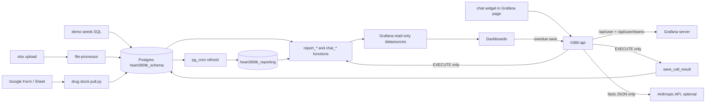
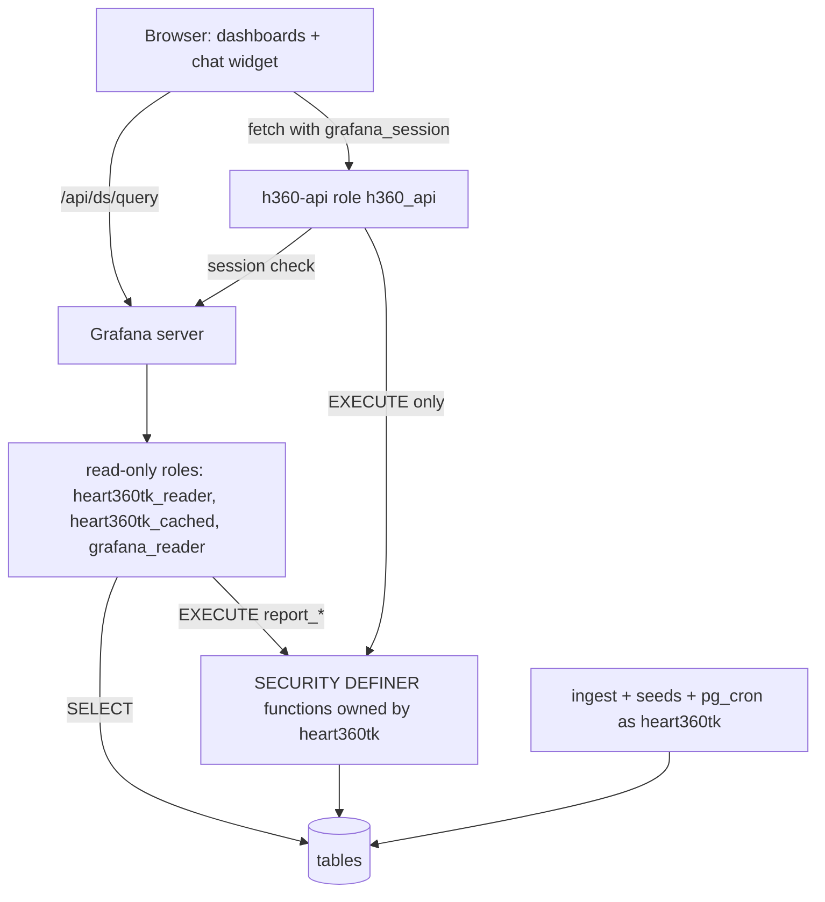
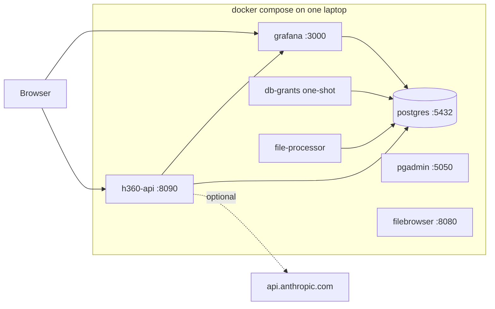
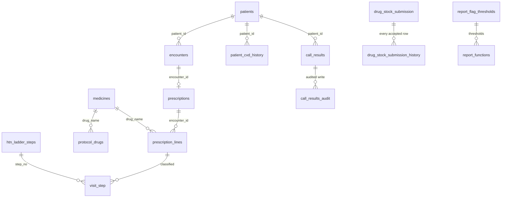

# Architecture Spine — HEARTS360 MVP integration branch

## Design Paradigm

**Pipes-and-filters for data, one write gateway, read-only dashboards.** The drug stock pipeline is unchanged in shape. Every report is a SQL filter over the same Postgres tables. Grafana and the chat only read. The one runtime write a user can make (an overdue call result) goes through `h360-api`, which asks Grafana who the user is and then calls one `SECURITY DEFINER` function.

| Stage | Owns | Must not |
| --- | --- | --- |
| Ingest (xlsx file-processor, drug stock `pull.py`, demo seeds) | Writing source rows as `heart360tk` | Run from a browser session |
| Postgres `heart360tk_schema` | Tables, `report_*` / `chat_*` functions, access rule, classifier | Trust a caller-supplied identity except from `h360-api` |
| Postgres `heart360tk_reporting` | Hourly copies for the HTN/DM tabs and patient-days | Hold new report logic |
| Grafana dashboards | Reading through read-only roles; `isAllowed` gating | Write SQL; compute clinical rules in panel SQL |
| `h360-api` | Session check, write validation, chat registry, ranker, wording | Free SQL; table privileges; patient rows to Claude |
| Chat widget | Drawing chips and answers; reading `var-org_unit` from the URL | Talk to Postgres or Claude directly |



## Inherited Invariants

The drug stock spine (2026-09-27) used AD-1 to AD-12. Those ids keep their meaning. New decisions start at AD-13.

| Inherited | From parent | Status here |
| --- | --- | --- |
| AD-1 Leaf-only boundary | drug stock spine | Kept |
| AD-2 Product code in `h360tk_grafana_core` | drug stock spine | Kept; covers all new work |
| AD-3 Postgres is store of record | drug stock spine | Kept |
| AD-4 Leaf pulls Sheet; dashboard role read-only | drug stock spine | Kept. Its "datasource role stays read-only" clause was false in code (owner role); AD-14 makes it true |
| AD-5 Latest Wins physical upsert | drug stock spine | **Superseded by AD-19** (order by `submitted_at`; history table) |
| AD-6 Facility identity is `org_units.id` | drug stock spine | Kept; wide-sheet facility cell parsing in AD-20 |
| AD-7 Single active programme | drug stock spine | Kept |
| AD-8 N from registered on the same `org_unit_id` | drug stock spine | **Superseded by AD-22** (sum over the facility subtree) |
| AD-9 Patient-Days in one SQL view | drug stock spine | Kept; amended by AD-22 (blank strength, All row in the same SQL) |
| AD-10 New dashboard; tree-only nav | drug stock spine | Kept; amended by AD-21 (access gate) and AD-29 (links) |
| AD-11 Dependency direction | drug stock spine | Kept; extended by the diagram under Invariants (one write edge via `h360-api`) |
| AD-12 In-Stock tri-state | drug stock spine | Kept |
| Convention "Sheet columns long rows" | drug stock spine | Amended by AD-20 (wide Form sheet is the primary input; long rows still accepted) |
| Deferred "append-only history" | drug stock spine | Now decided by AD-19 |

## Invariants & Rules



### AD-13 — Merge is done; the migration chain is renamed once and pre-allocated [ADOPTED]

- **Binds:** FR-15, FR-16, FR-17, NFR-2, NFR-5; every unit that adds SQL
- **Prevents:** Two units editing `01_heart360_tables.sql` at once; colliding migration names; an upgrade path that differs from a fresh install
- **Rule:**
  - The merge is commit `3b76cc9` (drug stock onto cascade-cohort). PR 5 and PR 7 stay out (A12, A13).
  - The merge-housekeeping unit runs first and alone. It `git mv`s the drug stock files: `0.5.1_to_0.5.2` → `0.6.0_to_0.6.1`, `0.5.2_to_0.5.3` → `0.6.1_to_0.6.2`, `0.5.3_to_0.5.4` → `0.6.2_to_0.6.3`, `0.5.4_to_0.5.5` → `0.6.3_to_0.6.4`, `0.5.5_to_0.5.6` → `0.6.4_to_0.6.5` (A14).
  - In the same commit it creates these placeholder files (header comment + `BEGIN; COMMIT;`) and all their `\ir` lines at the end of `01_heart360_tables.sql`, in this order: `0.6.5_to_0.6.6` security, `0.6.6_to_0.6.7` drug stock fixes, `0.6.7_to_0.6.8` medicine model, `0.6.8_to_0.6.9` report common + adherence, `0.6.9_to_0.6.10` titration, `0.6.10_to_0.6.11` fudging, `0.6.11_to_0.6.12` statins, `0.6.12_to_0.6.13` overdue calling + new patients, `0.6.13_to_0.6.14` chat levers + `report_flags`. It also updates the filenames and `\ir` checks in the five `verify_*.sh` scripts.
  - After that, a unit edits only its own migration file. Nobody else touches `01_heart360_tables.sql`.
  - Every migration is one transaction, idempotent and re-runnable (`IF NOT EXISTS`, `CREATE OR REPLACE`, `ON CONFLICT DO NOTHING`). It starts with `SET ROLE heart360tk`, except where AD-14 requires `RESET ROLE`.
  - Order is version order, the order of the `\ir` lines (`0.6.9_to_0.6.10` runs before `0.6.10_to_0.6.11`), never lexical file-name order. Verify scripts and the upgrade path follow the `\ir` list.
  - Upgrade from a 0.6.0 database is: run the 0.6.x files in that order with `psql -U h360tk_root`. `0.5.1_to_0.6.0.sql` stays as the 0.5.1 → 0.6.0 step and is not `\ir`'d.

### AD-14 — Every dashboard datasource is a read-only role

- **Binds:** FR-24, NFR-3; files `grafana_provisioning/datasources/*.yml`, `grafana_provisioning/config/grafana.ini`, migration `0.6.5_to_0.6.6`, `db_grants/grafana_reader_grants.sql`, `docker-compose.yml`
- **Prevents:** A Viewer posting `INSERT`/`UPDATE`/`DELETE` to `/api/ds/query`; a Viewer editing `grafana_schema."user"`; admin escalation through `GrafanaApi`
- **Rule:**
  - `0.6.5_to_0.6.6` starts with `RESET ROLE`, because creating roles and `ALTER ROLE ... SET` need the superuser session that runs the init scripts. It creates roles in idempotent `DO` blocks, then switches to `SET ROLE heart360tk` for its functions.
  - Roles and grants follow the **Grant matrix** below exactly. Write protection comes from privileges. `default_transaction_read_only = on` is only a second layer, because a session can turn it off.
  - `postgres-hypertension` keeps its uid and its name. It now connects as `heart360tk_reader`, with `editable: false`.
  - `postgres-grafana` keeps its uid and connects as `grafana_reader`.
  - `postgres-hypertension-cached` keeps `heart360tk_cached`.
  - `grafana_api.yml` is deleted, plus a `deleteDatasources` entry for `GrafanaApi` so upgraded volumes lose it too.
  - `grafana.ini` sets `auto_assign_org_role = Viewer` [ASSUMPTION A66].
  - [ASSUMPTION A60] Grafana creates `grafana_schema` tables at its first start, so the `grafana_reader` column grants live in `db_grants/grafana_reader_grants.sql`. A one-shot compose service `db-grants` (image `postgres:16-alpine`, `restart: "no"`) waits until `to_regclass('grafana_schema.team_member')` is not null. It then applies the file as `h360tk_root` on every `compose up`. Until it has run, `postgres-grafana` queries fail closed.

### AD-15 — Function privilege hygiene

- **Binds:** every migration from `0.6.5_to_0.6.6` on; all `SECURITY DEFINER` functions
- **Prevents:** A new definer function becoming callable by every role through the default `PUBLIC` grant; search-path hijack inside definer functions
- **Rule:**
  - `0.6.5_to_0.6.6` runs `ALTER DEFAULT PRIVILEGES FOR ROLE heart360tk REVOKE EXECUTE ON FUNCTIONS FROM PUBLIC`. This is the global form: the `IN SCHEMA` form cannot revoke the global PUBLIC default.
  - The same migration revokes `PUBLIC` from every existing `prosecdef` function in both schemas and re-grants each one per the matrix.
  - `h360_access_allows`, `save_call_result`, `report_*`, `chat_*`, `report_window` and `report_flags` are `SECURITY DEFINER`. Other new helpers (`parse_obat`, `classify_visit_step`) are invoker.
  - Every new function: owner `heart360tk`; `SET search_path = heart360tk_schema, pg_temp` (reporting objects schema-qualified); `REVOKE ALL ... FROM PUBLIC`; an explicit `GRANT EXECUTE` to the matrix roles, in the same migration file that creates it.
  - `get_descendant_ids` has no pinned search path, so callers must pin theirs.
  - `scripts/verify_security.sh` lists every function each login role can execute (`has_function_privilege`) and fails on anything outside the matrix.

### AD-16 — `h360-api` is the only runtime write path

- **Binds:** FR-25, FR-27, NFR-3, NFR-7; `h360_api/`; `save_call_result`, `h360_access_allows`, table `call_results_audit` (all three created in `0.6.5_to_0.6.6`)
- **Prevents:** Identity taken from the request body; a second access rule that drifts from `isAllowed`; cross-site writes
- **Rule:**
  - **Identity.** Every request forwards only the incoming `grafana_session` cookie to `GET http://grafana:3000/api/user` and `GET /api/user/teams`. Non-200 → `401`. `is_admin` = `isGrafanaAdmin`; teams = the team `name` list. Nothing about identity is read from the body.
  - **Access rule.** SQL `h360_access_allows(p_is_admin boolean, p_team_names text[], p_org_unit_id integer) RETURNS boolean` reproduces the program dashboard `isAllowed` query clause for clause: admin; empty/0 node with an `_ALL` team; a team in `get_access_groups(ancestor, 'aggregated'|'patients')` over the node's lineage; an `_ALL` team at a level ≤ the node's. A verify matrix (user × team × node) asserts it equals the dashboard SQL.
  - **Write.** `save_call_result(p_actor_login text, p_actor_id bigint, p_is_admin boolean, p_team_names text[], p_patient_id bigint, p_status text) RETURNS jsonb`. It rejects a missing patient (`not_found`), a status outside the 11 overdue-list strings (`bad_status`) and a denied access rule on the patient's `org_unit_id` (`forbidden`). The strings are `Pending to call`, `Agreed to visit`, `Call again later`, `Already visited puskesmas`, `Multiple failed contact attempts`, `Wrong phone number`, `Moved out of catchment area`, `Transferred to another puskesmas`, `Refused to return`, `Died` and `Other reason`.
    - Otherwise it upserts on `(patient_id, CURRENT_DATE)` with today's semantics. `result_type` is NULL for `Agreed to visit`, `Pending to call` and `Call again later`, else `removed_from_overdue_list`. `removed_reason` = status; `org_unit_id` = the patient's.
    - It appends one `call_results_audit` row (actor, patient, status, time).
  - **HTTP.** `POST /write/call-result` with body `{"patient_id": "<digits>", "status": "<string>"}` → `200` `{"ok":true,...}` | `400` | `401` | `403`.
  - **CSRF/CORS.** Require `Content-Type: application/json` and header `X-H360-Request: 1`. If an `Origin` header is present it must be in `H360_ALLOWED_ORIGINS` (default `http://localhost:3000,http://127.0.0.1:3000`). CORS answers with that exact origin and `Allow-Credentials: true`.

### AD-17 — Only the Overdue tab's save paths change in the program dashboard

- **Binds:** FR-26, NFR-1 (A15); `heart360.hypertension-diabetes.program.json`
- **Prevents:** Drift in the HTN/DM tabs; any overdue save path still posting SQL
- **Rule:**
  - `panel-ov-quick` `save()` replaces its `/api/ds/query` call with `fetch(H360_API + '/write/call-result', {method:'POST', credentials:'include', headers:{'Content-Type':'application/json','X-H360-Request':'1'}, body})`, where `H360_API = location.protocol + '//' + location.hostname + ':8090'`. The Saving / Saved / error-toast behaviour is unchanged.
  - `panel-ov-1` ("All columns & download") drops its `update` block and becomes a read-only table [ASSUMPTION A59]. Business Table updates only through a datasource, and Grafana strips its own login cookie before forwarding cookies to a backend datasource such as Infinity. A datasource path therefore cannot carry the user's identity to `h360-api`. The quick list is the one save path.
  - The only other program-dashboard edit allowed is one `spec.links` entry (AD-29). `scripts/check_htn_dm_untouched.py` must pass.

### AD-18 — Security gate before any new write, report or chat

- **Binds:** NFR-3, FR-27, SM-4; build order
- **Prevents:** Report or chat work merging onto an open write hole
- **Rule:** `scripts/verify_security.sh` runs against the live compose stack as two demo Viewers. It fails the build unless all of the following hold:
  - Direct `INSERT`, `UPDATE`, `DELETE` and `SELECT set_config('default_transaction_read_only','off',false)` + `INSERT` posted to `/api/ds/query` on all three Postgres datasources are refused.
  - `UPDATE "user"` via `postgres-grafana` is refused.
  - `POST /write/call-result` with no cookie → `401`; for a patient outside the Viewer's location → `403` with no row written; for an allowed patient → `200` with one `call_results` row and one audit row.
  - `GrafanaApi` is absent.
  - The function allowlist (AD-15) holds.

  Report units (AD-26 on) merge only after this script passes on the branch.

### AD-19 — Drug stock Latest Wins by `submitted_at`, with history (supersedes AD-5)

- **Binds:** FR-19, FR-21; migration `0.6.6_to_0.6.7`; `drug_stock_pull_apply`
- **Prevents:** Sheet row order deciding the stored value; a re-pull overwriting a newer value with an older one; history that disagrees with the board
- **Rule:**
  - Add `submitted_by text` and `sheet_row integer` to `drug_stock_submission`.
  - Add the append-only `drug_stock_submission_history`: every accepted row, unique on `(org_unit_id, reporting_month, rxnorm_code, submitted_at, sheet_row)` with `ON CONFLICT DO NOTHING`, so re-pulls never duplicate it.
  - `drug_stock_pull_apply(rows jsonb)` processes rows ordered by `submitted_at NULLS FIRST, sheet_row`.
  - The upsert updates only when `existing.submitted_at IS NULL OR (new.submitted_at IS NOT NULL AND new.submitted_at >= existing.submitted_at)`, so ties go to the later-ingested row.
  - It stays the only writer of drug stock rows: `pull.py`, fixtures and demo seeds all call it.

### AD-20 — Wide Form sheet is the primary pull input

- **Binds:** FR-20, FR-21 (A33); `drug_stock/pull/pull.py`, `form_field_spec.json`, new `fixture_wide_form.json`
- **Prevents:** Manual reshaping of Form responses; two parsers with different blank rules
- **Rule:**
  - **Detection.** The sheet is wide if its header row has `Timestamp` and at least one column whose label is in `form_field_spec.json`. Otherwise it is the existing long layout (`A:E`).
  - **Wide parsing.** Read the full used range with `valueRenderOption=UNFORMATTED_VALUE`, `dateTimeRenderOption=SERIAL_NUMBER`, and convert serials using the spreadsheet `timeZone`. Each response row becomes one long row per spec column:
    - `submitted_at` ← `Timestamp`; `submitted_by` ← `Email Address`;
    - `org_unit_id` ← `Facility` (all digits, or the trailing `(digits)` of `Name (id)`);
    - `reporting_month` ← `Reporting Month`, normalised to the first of the month;
    - `rxnorm_code` from the spec; `sheet_row` = the 1-based sheet row.
  - **Cell values.** Blank or `?` → `in_stock` NULL (AD-12). A non-numeric value → reject table. Both layouts end in one `drug_stock_pull_apply` call.

### AD-21 — Drug stock board is access-gated like the HTN tabs

- **Binds:** FR-22 (A24); `heart360.drug.stock.json`
- **Prevents:** A district user seeing other districts' stock; a second access rule
- **Rule:** The board gains the `isAdmin`, `isAllowed` and `requiredGroups` variables, copied verbatim from the program dashboard (`postgres-grafana`). Every data query ends `WHERE '$isAllowed' = '1'`. An access banner panel copies the program dashboard's no-access message.

### AD-22 — Patient-Days: blank strength, the All row, and subtree N (supersedes AD-8, amends AD-9)

- **Binds:** FR-23; `heart360tk_reporting.drug_stock_patient_days`, `drug_stock_on_hand_matrix`
- **Prevents:** A partial category sum shown as a number; non-reporting facilities diluting the All row; N = 0 because patients sit at level 4
- **Rule:**
  - A category is known for a facility-month only if every active stock-tracked drug of that category has a stored non-NULL `in_stock`. Otherwise the category's Patient-Days is NULL (shown `—`) [ASSUMPTION A50].
  - N = `SUM(cumulative_number_of_patients)` from `heart360tk_reporting.heart360_patients_registered` over `get_descendant_ids(facility)` at `ref_month = reporting_month` [ASSUMPTION A51].
  - The All row = `SUM(normalized_stock) / (SUM(N) × load × coeff)` over only the facilities whose category is known. It also returns `reporting_n` and `cohort_n` for a coverage line. The `-1` (submitted null) marker is kept.
  - A cohort must not contain both a node and its descendant (verify check). The demo cohort is the six PHCs.

### AD-23 — `medicines` is the one medicine catalogue

- **Binds:** FR-28, FR-29, FR-39; migration `0.6.7_to_0.6.8`
- **Prevents:** Drug lists duplicated between drug stock, the classifier and statins; name-spelling drift
- **Rule:**
  - `medicines(drug_name text PK, aliases text[], drug_class text, ladder_class text CHECK IN ('CCB','RAAS','THIAZIDE') NULL, htn_role text CHECK IN ('protocol','non_protocol','not_htn'), is_statin boolean, start_mg_day numeric, full_mg_day numeric, stock_category text NULL)`.
  - `drug_name` uses display case. `aliases` are lowercase and include the lowercase name.
  - `protocol_drugs.drug_name` gets an FK to `medicines`, and a verify check asserts `protocol_drugs.drug_category = medicines.stock_category`.
  - Seed rows are in `CLINICAL-RULES.md`: the protocol drugs, about 70 whitelisted non-protocol and non-HTN names, and three statins [ASSUMPTION A49]. Nobody hard-codes a drug name in report SQL; reports test `ladder_class`, `htn_role` and `is_statin`.

### AD-24 — Prescriptions are stored raw and parsed by one SQL function

- **Binds:** FR-28 (A2, A23); `prescriptions`, `prescription_lines`, `parse_obat`
- **Prevents:** A Python parser and a SQL parser disagreeing; dropped unreadable entries
- **Rule:**
  - `prescriptions(encounter_id bigint PK REFERENCES encounters ON DELETE CASCADE, obat_raw text NOT NULL, source text NOT NULL DEFAULT 'demo')`.
  - `prescription_lines(encounter_id, line_no, raw_line, drug_name NULL REFERENCES medicines, strength_mg, doses_per_day, tablets_per_dose, daily_mg, parse_status CHECK IN ('ok','unknown_drug','unparsed'), PK (encounter_id, line_no))`.
  - Lines are written only by an `AFTER INSERT OR UPDATE OF obat_raw` trigger calling `parse_obat(text)`. The grammar and test strings are in `CLINICAL-RULES.md`.
  - `daily_mg = strength_mg × doses_per_day × tablets_per_dose`. An unparsed line is kept with NULL fields.

### AD-25 — The ladder is data; one classifier assigns every visit

- **Binds:** FR-29, FR-33, FR-35; `htn_ladder_steps`, view `visit_step`, function `classify_visit_step`
- **Prevents:** Each report re-deriving Step; a ladder change needing code edits
- **Rule:**
  - `htn_ladder_steps(step_no, ccb_level, raas_level, thz_level, label, PK (ccb_level, raas_level, thz_level))` allows several tuples per step and is seeded with the coordinator ladder (CR-1) [ASSUMPTION A49; A2, A3].
  - View `visit_step(encounter_id, bucket, step_no, reason, n_htn_drugs, dose_units)` is the only classifier. `classify_visit_step(encounter_id)` is a thin wrapper over it.
  - All reports and chat functions join `visit_step`. The bucket rules are CR-1.

### AD-26 — One window, one attribution, one aggregation for all reports

- **Binds:** FR-33 to FR-42, FR-45 (A34, A48); every `report_*` and `chat_*` function
- **Prevents:** Tabs and chat using different periods or different facility attribution, so their numbers disagree
- **Rule:** `report_window(p_reporting_month date) RETURNS TABLE(window_start date, window_end date, data_end date)` is the only period source.
  - `window_end` is the last day of the month. A NULL month means the latest completed month.
  - `window_start = window_end − 89`.
  - `data_end` is the newest `encounter_date::date ≤ window_end`.
  - A patient belongs to the subtree of `patients.org_unit_id` [ASSUMPTION A52]. Node selection is `get_descendant_ids(node)`, where 0 or NULL means all.
  - Rates are `sum(numerator)/sum(denominator)` over patients or visits, never averages of facility rates.
  - Flags compare the displayed rounded value (percent to 1 decimal, score to 2 decimals) against `report_flag_thresholds`.

### AD-27 — Report function contract

- **Binds:** FR-31 to FR-42, FR-44, FR-45; migrations `0.6.8_to_0.6.9` to `0.6.13_to_0.6.14`; every report panel and chat query
- **Prevents:** Panels re-implementing rules; chat numbers that differ from tab numbers; per-tab threshold literals
- **Rule:**
  - **Signature.** Each report is `report_<name>(p_reporting_month date, p_org_unit_id integer)`, a `STABLE SECURITY DEFINER` function. Names: `adherence`, `adherence_buckets`, `titration`, `fudging`, `fudging_histogram`, `statins`, `statins_patients`, `calling`, `new_patients`. Only `report_adherence*` adds a third parameter: `p_include_new boolean DEFAULT false`.
  - **Rows.** The first row is the selection (or `All places in view`, `org_unit_id = 0`) aggregated over its subtree. Then one row per level-3 facility in the subtree when the selection is above level 3.
  - **Columns.** Standard columns: `org_unit_id, org_unit_name, level, is_selected, too_few, flag, flag_reason`, then the measure columns named in `CLINICAL-RULES.md`. The exceptions are the selection-only `report_adherence_buckets`, `report_fudging_histogram` and the patient list `report_statins_patients`, whose columns are listed there.
  - **Flags.** `report_flags(p_reporting_month, p_org_unit_id)` unions the flags of all five reports. It is created in `0.6.13_to_0.6.14`, after every report exists. It feeds `Also flagged on …` and the flagged-first sort (A35).
  - **Thresholds.** All thresholds and minimums (A36, A37, A38, A57, Chattogram) are rows in `report_flag_thresholds(report, key, value)`. `0.6.8_to_0.6.9` creates the table and seeds every row listed in `CLINICAL-RULES.md`. No literal appears in report SQL, panels or `h360-api`.
  - **Grants.** Patient-level `report_statins_patients` is granted to `heart360tk_reader` only. Everything else goes to `heart360tk_reader` and `h360_api`.

### AD-28 — One Reports dashboard, assembled from one source file per report

- **Binds:** FR-31, FR-32, NFR-4 (A22, A34, A43, A44, [ASSUMPTION A64]); `dashboard_src/reports/`, `scripts/build_reports_dashboard.py`, `heart360.reports.json`
- **Prevents:** Five units colliding in one large JSON; five dashboards with drifting variables and trees
- **Rule:**
  - Each report owns `dashboard_src/reports/<n>-<slug>.json` = `{"title", "elements", "layout"}`. Its element keys start with `panel-<slug>-` (slugs `adherence`, `titration`, `fudging`, `statins`, `calling`; `n` fixes tab order 1–5).
  - `_shell.json` owns the rest:
    - v2 `dashboard.grafana.app/v2` metadata, uid `heart360_reports`, title `HEARTS360 Reports`;
    - variables copied verbatim from the program dashboard (`org_unit`, `isAdmin`, `isAllowed`, `requiredGroups`, `selected_level`), plus `reporting_month` (`YYYY-MM-DD` first-of-month, last 12 completed months, default the latest completed) and `include_new` (custom: `false` = `Established patients only`, the default; `true` = `Include new patients`);
    - the layout `RowsLayout[Change location (collapsed, tree panel) , untitled row → TabsLayout]`.
  - The build script merges the files deterministically. It fails on a duplicate or unprefixed key and writes `grafana_provisioning/dashboards/HEARTS360 Dashboards/heart360.reports.json`, which is committed. `--check` fails if the committed file is stale.
  - Panels call `report_*` only, through `postgres-hypertension`, ending `WHERE '$isAllowed' = '1'`. They reuse the cascade tokens and shared `tip()` (NFR-4).

### AD-29 — Navigation links

- **Binds:** FR-31, FR-43 report links; `heart360.home.json`, program, drug stock and Reports dashboards
- **Prevents:** Broken or divergent deep links to a report tab
- **Rule:**
  - A link to a report tab is `/d/heart360_reports?var-org_unit=<id>&var-reporting_month=<YYYY-MM-DD>&-dtab=<Tab-slug>`, with tab slugs `Protocol-adherence`, `Titration`, `BP-fudging`, `Statins` and `Overdue-calling`. The `-dtab` key belongs to tabs inside an untitled row, as `home.json` already uses with `-dtab=Hypertension`.
  - Links added [ASSUMPTION A65]:
    - `home.json`: a `Reports` entry in its dashboard links list; the redirect script is unchanged.
    - Program dashboard: one `spec.links` entry `Reports` (AD-17).
    - Drug stock board: a link to Reports.
    - Reports `_shell.json`: links to the program and drug stock dashboards.

### AD-30 — Chat answers only from a fixed registry of stored queries

- **Binds:** FR-43, FR-44, FR-46, NFR-7 (A9, A25, A26, A41); `h360_api/registry.py`
- **Prevents:** Free SQL; chat numbers from a different query than the tabs; patient rows reaching Claude
- **Rule:**
  - **Registry.** The registry is a Python dict keyed by PRD query name. Each entry names one SQL function; its only parameters are `org_unit_id` and `reporting_month`.
  - **Entries.** `control_summary`, `new_patient_return`, `phone_capture`, `overdue_calling`, `titration_rate`, `fudging_score`, `statin_gap`, `drug_stock_gate`, `facility_rank_district` and `call_plan`. Each maps to a `report_*` function where a tab shows the number, else to `chat_*`. `first_appointment_gap` is Deferred.
  - **Access.** Before any query `h360-api` checks `h360_access_allows` for the scope node; a refusal returns `403`, and the widget prints `You do not have access to this place.`
  - **Scope.**
    - Level ≥ 3 → facility (the level-3 ancestor).
    - Level 2 → district.
    - Level ≤ 1 or empty → national (`Pick a district`).
  - **Chips.** Chip ids and labels are exactly the UX table (`why_control_low`, `who_to_call`, `medicines_adjusted`, `readings_reliable`, `statin_gap`, `visit_first`, nudges `call_plan`).
  - **Typed text.** It is matched to a chip by a keyword table, else `I can only answer the questions above. Pick one.`
  - **Endpoints.** `GET /chat/chips?org_unit_id&reporting_month` returns `{scope, place, month, mode, chips: [{id, label}]}`. `POST /chat` takes `{"chip_id"|"text", "org_unit_id", "reporting_month"}`.
  - **Answer shape.** `POST /chat` returns `{mode, place, month, reasons, also_check, stock_line, nudge, plan, honesty, links}`:
    - `mode` ∈ `claude`, `offline`, `offline_fallback`;
    - `place` = `{org_unit_id, name, level, scope}`, where `org_unit_id` is the scope node (a level-4 selection answers for its level-3 facility);
    - `reasons` = up to 3 of `{lever, text, number, what_to_do, link}`;
    - `also_check` and `stock_line` are a string or null;
    - `nudge` = `{chip_id, label}` or null;
    - `plan` = `{total, weeks: [w1, w2, w3, w4], text}` or null;
    - `links` = `[{label, url}]`, built with AD-29 and the scope node id.
  - **Widget contract.** The widget renders only these fields.

### AD-31 — Deterministic evidence ranker

- **Binds:** FR-45, FR-47 (A27, A57); `h360_api/ranker.py`
- **Prevents:** Claude or prompt wording changing the order or the numbers; "Also check" drifting from tab flags
- **Rule:**
  - **Levers by tier.**
    1. `new_patient_return`: loss > 25%.
    2. `phone_capture`: usable < 90%.
    3. `overdue_calling`: called < 10% or early < 50%.
    4. `titration_rate`: < 40%.
  - **Order and count.** Triggered levers are ordered by tier, then gap to threshold (descending); take at most 3. If fewer than 2 triggered, pad to 2 with the lowest-tier untriggered lever, worded as on target. If no data or too few: one plain sentence, no ranking.
  - **Stock gate.** If any protocol category's Patient-Days < 30 for the place-month (`drug_stock_gate`), the calling and titration reasons get `Fix stock first.`, and a stock line is added.
  - **Also check.** It names at most one place in scope with control ≥ 60% (A36) and a fudging or titration flag from `report_flags`.
  - **District `visit_first`.** Facilities with a Chattogram breach (control < 50%, uncontrolled > 20%, missed visits > 25%, LTFU > 20%) are sorted by uncontrolled patient count. Take the top 3, and reserve the third slot for an "Also check" facility if one exists.
  - Control percentages come from `chat_control_summary`, which copies the HTN tab formulas (`nb_patients_controlled / nb_patients_under_care_registered_before_the_past_3_months` from `heart360tk_reporting.heart360_patients_category`).

### AD-32 — Claude writes wording only; the server owns numbers and honesty

- **Binds:** FR-45, FR-48, FR-49, NFR-7, NFR-8 (A7, A26, A47); `h360_api/wording.py`
- **Prevents:** Invented numbers; banned promise words; the key in the browser; a chat that fails with no network
- **Rule:**
  - **Offline answer.** The ranker emits a facts JSON (place name, month, reasons with numbers and offline sentences). The offline template turns it into the answer, and is always computed.
  - **Claude call.** Only when `ANTHROPIC_API_KEY` is set: one `messages.create` call (model `ANTHROPIC_MODEL`, default `claude-sonnet-5-5` [ASSUMPTION A58], 8 s timeout) rewrites the facts JSON sentences. Claude sees no patient rows, names or ids.
  - **Checks on the reply.**
    - Every number token in the reply must be in the facts.
    - No `will`, `guarantee`, `guarantees` or `guaranteed`.
    - No sentence over 20 words; at most 150 words.
    - On any failure or timeout, fall back to offline and set `mode = offline_fallback`.
  - **Honesty line.** The server appends it verbatim after the checks; it is never sent through Claude.
  - **Key handling.** The key is read from env only, never logged, never sent to the browser.

### AD-33 — The chat widget is injected into Grafana's page shell at image build

- **Binds:** FR-43 (A17, A40); `docker_build/grafana_public/h360/chat-widget.js`, Grafana Dockerfile
- **Prevents:** A widget that silently disappears after a Grafana upgrade; widget code that calls Postgres or Claude
- **Rule:**
  - **Build.** The Dockerfile copies the file to `/usr/share/grafana/public/h360/` and inserts `<script nonce="[[.Nonce]]" src="public/h360/chat-widget.js" defer></script>` before the single `</body>` of `/usr/share/grafana/public/views/index.html`. The build fails unless the tag appears exactly once.
  - **Signed-in check.** The widget renders only when `window.grafanaBootData.user.isSignedIn`.
  - **URL.** It reads `var-org_unit` from `location.search`, re-reading on `popstate` and a 1 s URL poll (Grafana is a single-page app). It sends `var-reporting_month` only on `/d/heart360_reports`, because the drug stock board's variable of the same name defaults to the current month. Elsewhere the server default (latest completed month) applies.
  - **Calls.** It calls only `H360_API` (AD-17) with `credentials:'include'` and `X-H360-Request: 1`.
  - **CSP.** Grafana `content_security_policy` stays off. If it is ever enabled, `connect-src` must include the `h360-api` origin.

### AD-34 — Fake data is deterministic, insert-only SQL seeds

- **Binds:** FR-18, FR-30, NFR-5 (A13, A32, A55, A56); `test_data/demo/seeds/*.sql`, `scripts/demo_users.sh`
- **Prevents:** A second loader; random numbers changing between runs; deleted or rewritten patient rows
- **Rule:**
  - **Files.** Seeds are `test_data/demo/seeds/NN_<name>.sql`, run in name order by `scripts/demo_up.sh` as superuser after the xlsx ingest. Each starts with `SET ROLE heart360tk` and runs only if its row is absent from `demo_seed_marker(seed PK, anchor date, applied_at)`.
  - **Randomness.** Every choice comes from `md5(<patient_id or encounter_id>||':'||<salt>)`, never `random()`. Dates are offsets from the anchor (the newest source encounter date, stored by the first seed).
  - **Writes.** Seeds only `INSERT` (with `ON CONFLICT DO NOTHING`) into `patients`, `patient_diagnoses`, `encounters`, `blood_pressures`, `prescriptions`, `patient_cvd_history` and `call_results`. Drug stock goes through `drug_stock_pull_apply`.
  - **Never.** No `UPDATE` or `DELETE` of existing rows; no `Died` call result.
  - **Order and targets.** The seed order and per-facility targets are in `CLINICAL-RULES.md` (Seed plan). The planted facilities are [ASSUMPTION A56]:
    - PHC-E: Kolfe-like (high control, fudging ≈ 5.4, titration ≈ 28%);
    - PHC-D: second-visit loss 36–40%;
    - PHC-C: low phone capture;
    - PHC-B: low CCB stock.
  - **Demo users.** `scripts/demo_users.sh` creates Viewers `district.d` (team `heart360tk_district_view_patients_district-d`) and `nurse.phc-a` (team `heart360tk_facility_view_patients_phc-a`) through the Grafana HTTP API, idempotently [ASSUMPTION A62].

### AD-35 — Every rule ships with a verify script and a hand-checked fixture

- **Binds:** NFR-9, SM-4, SM-5; `pg_init_scripts/migrations/verify_*.sh`, `scripts/verify_*.sh`
- **Prevents:** Rules that only "look right" on demo data; verify scripts that cannot run on the demo machine
- **Rule:**
  - **Script shape.** Each report and fix migration has `verify_<topic>.sh`. It builds a scratch database, loads the chain, inserts the fixture from `CLINICAL-RULES.md`, and asserts the exact numbers.
  - **psql command.** Scripts take `PSQL="${PSQL:-sudo -u postgres psql}"`; the demo uses `PSQL="docker exec -i postgres psql -U h360tk_root"`.
  - **Stack checks.** `scripts/verify_dashboard_queries.py` runs every provisioned panel and variable SQL as its datasource's role, with sample variables, and fails on any permission or syntax error. `scripts/verify_all.sh` runs every check, including `check_htn_dm_untouched.py`, `build_reports_dashboard.py --check` and `verify_security.sh`.

## Grant matrix

| Role | Used by | May | Must not |
| --- | --- | --- | --- |
| `heart360tk` | importer, exporter, file-processor, pg_cron, `pull.py`, seeds (via `SET ROLE`) | Own everything in both schemas | Back any Grafana datasource or `h360-api` |
| `heart360tk_reader` (new, LOGIN) | `postgres-hypertension` | USAGE both schemas; SELECT all tables/views (plus `ALTER DEFAULT PRIVILEGES FOR ROLE heart360tk ... GRANT SELECT ON TABLES`); EXECUTE invoker helpers, `report_*` incl. `report_statins_patients`; `search_path = heart360tk_schema, public`; `default_transaction_read_only = on` | Any write; EXECUTE `save_call_result`, `drug_stock_pull_apply`, `delete_leaf_node_data`, `start_async_refresh`, `H360TK_ADMIN_CLEAN_DATA`; membership in `heart360tk` |
| `heart360tk_cached` | `postgres-hypertension-cached` | Existing SELECT grants; `default_transaction_read_only = on` | Any write or definer function |
| `grafana_reader` (new, LOGIN) | `postgres-grafana` | Column SELECT on `grafana_schema."user"(id, login, is_admin, org_id)`, `team(id, name, org_id)`, `team_member(user_id, team_id, org_id)`; the `heart360tk_schema` reads `grafana` has today; EXECUTE `get_access_groups`, `get_user_visible_org_units`, `start_async_refresh`; `search_path = grafana_schema, public` | Any other `grafana_schema` column or table; any write |
| `grafana` | Grafana server database only (`GF_DATABASE_URL`) | Own `grafana_schema` | Back a datasource |
| `h360_api` (new, LOGIN) | `h360-api` | USAGE `heart360tk_schema`; EXECUTE `h360_access_allows`, `save_call_result`, aggregate `report_*`, `chat_*`, `report_window`, `report_flags` | Any table privilege; `report_statins_patients` |

## Clinical Rules

Precise definitions; worked fixtures, column lists and parser cases are in `CLINICAL-RULES.md`. Common to all: AD-26 window, attribution and aggregation. "Alive" = `patient_status IS DISTINCT FROM 'DEAD'`. "Controlled" = systolic < 140 and diastolic < 90; a visit without a BP row is not controlled and is not uncontrolled.

### CR-1 — Ladder and classifier [ASSUMPTION A49; A2, A3]

**Ladder (seed of `htn_ladder_steps`):**

| Step | Medicines | (CCB, RAAS, THIAZIDE) level |
| --- | --- | --- |
| 1 | amlodipine 5 mg | (1, 0, 0) |
| 2 | amlodipine 10 mg | (2, 0, 0) |
| 3 | amlodipine 10 + ACE inhibitor/ARB standard dose | (2, 1, 0) |
| 4 | amlodipine 10 + ACE inhibitor/ARB maximum dose | (2, 2, 0) |
| 5 | Step 4 + thiazide 12.5 mg | (2, 2, 1) |
| 6 | Step 4 + thiazide 25 mg | (2, 2, 2) |

**Class level:**
- The class daily mg is the summed `daily_mg` of that class's one drug.
- Level 0 = class absent.
- Level 1 = `start_mg_day ≤ daily < full_mg_day`.
- Level 2 = `daily ≥ full_mg_day`.

**Buckets for one encounter, first match wins:**
1. No `prescriptions` row → `Unrecognized` / `no_prescription`.
2. Any line whose drug has `htn_role = 'non_protocol'` → `Non-Protocol`.
3. Any line `unparsed` or `unknown_drug` → `Unrecognized` / `unreadable`.
4. No line with `htn_role = 'protocol'` → `Unrecognized` / `no_htn_medicine`.
5. Two distinct drugs in one ladder class, or any class below `start_mg_day` → `Other Protocol`. Lines of the same drug are summed first [ASSUMPTION A67].
6. The level tuple is in `htn_ladder_steps` → `Step n`.
7. Otherwise → `Other Protocol`.

`not_htn` lines (statins, metformin) are ignored for buckets. `n_htn_drugs` = distinct HTN drugs (protocol and non-protocol). `dose_units` = Σ `daily_mg / full_mg_day` over HTN lines, counting 1.0 when `full_mg_day` is NULL.

### CR-2 — Protocol adherence (FR-33, FR-34; A42, A44)

- **Cohort:** alive patients with diagnosis `I10` and at least one encounter in the window.
  - Registration = the patient's earliest encounter date, as the adherence tool does (A2).
  - Strict (default): registration `< window_start`.
  - Lenient (`p_include_new`): all of them.
- **Row:** the bucket of the patient's latest encounter in the window. Controlled is taken from that encounter's BP.
- **Counts:** bucket counts sum to the cohort; controlled % per bucket uses the same patients.
- **Measures:**
  - `off_protocol_pct` = (Non-Protocol + Other Protocol) / cohort;
  - `one_medicine_pct` = (Step 1 + Step 2) / cohort.
- **Flags:** off-protocol ≥ 20% or one-medicine ≥ 60% (A38). `too_few` when the cohort < 20 (A37).

### CR-3 — Titration (FR-35, FR-36; A19)

- **Uncontrolled visit v:** an encounter in the window with a BP row and systolic ≥ 140 or diastolic ≥ 90.
- **Exclusions:**
  - Too recent: `v::date > data_end − 30` is excluded and counted (`excluded_too_recent_n`).
  - No baseline: the baseline B is the patient's latest encounter before v. If there is no B, or B's bucket is `Unrecognized` with reason `no_prescription` or `unreadable`, v is excluded and counted (`excluded_no_baseline_n`).
- **Candidates:** v itself, and the patient's first encounter in `(v, v + 30 days]`.
- **Stepped up:** if any candidate C is a step-up over B:
  - both on the ladder and `step_no(C) > step_no(B)`; or
  - otherwise C is not `Unrecognized` and (`n_htn_drugs(C) > n_htn_drugs(B)`, or the counts are equal and `dose_units(C) > dose_units(B)`) [ASSUMPTION A68].

  A B with `no_htn_medicine` has `n_htn_drugs = 0`, so any HTN treatment at C counts.
- **Rate:** `titration_pct` = stepped-up visits / remaining uncontrolled visits (visit-level).
- **Flag:** < 40%. `too_few` when fewer than 10 uncontrolled visits (A37). Fixture: 59 of 200 = 29.5% is flagged (Kolfe).

### CR-4 — BP fudging (FR-37, FR-38; A5, A20, A36, A39)

- **Readings:** every `blood_pressures` row of an encounter in the window.
- **Counts:** `a` = count `135 ≤ systolic < 140`; `b` = count `140 ≤ systolic < 145`.
- **Score:** `round(a::numeric / b, 2)`.
- **Cases:**
  - `a + b < 20` → `too_few` (`Too few readings`), no score.
  - `b = 0` → score NULL, flag true, reason `No 140-144 readings`.
  - Otherwise flag when score ≥ 2.00.
- **Looks fine, check readings:** `control_pct` (the HTN tab formula, AD-31) ≥ 60% and flagged.
- **Histogram:** `report_fudging_histogram` returns systolic bands 120–154 in 5s.
- **Fixtures:** 541/100 = 5.41; 542/100 = 5.42 (Kolfe); 200/100 = 2.00 flagged; 199/100 = 1.99 not flagged.

### CR-5 — Statins (FR-39, FR-40; A4, A29)

- **Eligible:** alive; at least one encounter in `[window_end − 364, window_end]`; `birth_date ≤ window_end − interval '40 years'`; and (`E11` diagnosis, or a `patient_cvd_history` row of type `MI` or `STROKE` with `event_date ≤ window_end`).
- **On a statin:** the patient's latest encounter ≤ `window_end` that has a `prescriptions` row has a line whose drug `is_statin`.
- **Measures:** `eligible_n`, `on_statin_n`, `on_statin_pct`, `not_on_statin_n`.
- **Flag:** < 25%. `too_few` when fewer than 10 eligible.
- **Patient list:** `report_statins_patients` returns, at a selection of level ≥ 3 only, the not-on-statin patients (`patient_id, patient_name, age, reason_eligible ∈ {Diabetes, Heart attack or stroke, Both}, last_visit_date`). Its count equals `not_on_statin_n`.

### CR-6 — Overdue calling and new patients (FR-41, FR-42, FR-46; A6, A21, A54)

- **Month M:** `M_start` = the reporting month; `M_end` = its last day.
- **Last visit:** the patient's latest encounter with `encounter_date < M_start`.
- **Overdue at start of M:** alive; last visit `< M_start − 45 days`; not removed (the latest `call_results` row with `last_visit < call_date < M_start` is not `result_type = 'removed_from_overdue_list'`). This matches `HEART360_OVERDUE_PATIENTS` / the overdue list, with no upper limit.
- **With a phone:** the phone has ≥ 8 digits.
- **Overdue since:** last visit + 45 days.
- **Called:** the first `call_results` row in `[M_start, M_end]` after the last visit with `removed_reason IS DISTINCT FROM 'Pending to call'`.
  - `days_to_call` = call date − overdue since. Early = `days_to_call ≤ 14`.
  - Outcome of that first call: `Agreed to visit`, `Call again later` or Removed (`result_type = 'removed_from_overdue_list'`).
- **Returned [ASSUMPTION A63]:** an encounter in `[call_date, call_date + 30]`. Return measures cover first calls (same "called" rule) made in `[window_start, window_end]`, so that the default month still shows returns. A call counts only when `call_date + 30 ≤` the newest `encounter_date::date` in the database; the rest are `return_not_yet_known_n`. Returns are split early vs later.
- **Rates:**
  - `called_pct` = called / overdue with a phone.
  - Flags: called < 10%, early < 50%. `too_few` when fewer than 10 overdue with a phone.
- **Reconciliation:** called ≤ `HEART360_OVERDUE_PATIENTS_CALLED` for the same node-month (equal on demo data). Returns do not reconcile with `HEART360_OVERDUE_RETURNED_TO_CARE`, which uses 15 days. The tab note says so.
- **Call plan:** `chat_call_plan` = overdue with a usable phone at the start of M, split as `ceil(n/4)` per week for four weeks. It matches the tab headline.
- **New patients (`report_new_patients`, shown on the Overdue calling tab) [ASSUMPTION A53, A54]:**
  - Cohort: patients whose first encounter is in `[window_end − 179, window_end − 90]`.
  - `new_loss_pct` = no encounter in `(first, first + 90 days]`.
  - `new_usable_phone_pct` = phone ≥ 8 digits and never marked `Wrong phone number`.
  - Flag phone captured < 50% (A38). The chat levers use A57.

## Consistency Conventions

| Concern | Convention |
| --- | --- |
| SQL naming | Tables snake_case singular-ish as existing; report functions `report_<name>`; chat-only functions `chat_<name>`; helpers `h360_*`; seeds `NN_<name>.sql`; verify scripts `verify_<topic>.sh` |
| Org unit parameter | `p_org_unit_id integer`, 0 or NULL = all; dashboards pass `NULLIF(NULLIF(TRIM('$org_unit'),''),'0')::int` exactly as the program dashboard does |
| Month | `p_reporting_month date` = first of month; dashboard variable `reporting_month` as `YYYY-MM-DD`; API JSON `"reporting_month": "YYYY-MM-DD"` |
| Percent and score display | percent 1 decimal, score 2 decimals, computed in `numeric` (never integer division) |
| Plain states | `No data for this place`, `Too few <cases> (minimum N)`, never a 0% for too few (FR-32); flag reasons ≤ 20 words, no abbreviation but BP (NFR-8) |
| Facility | Level 3 per `hierarchy_config`; level 4 rolls up to its level-3 ancestor |
| API errors | JSON `{"ok": false, "error": "<code>", "message": "<plain sentence>"}`; codes `unauthenticated`, `forbidden`, `bad_request`, `not_found` |
| Secrets | `ANTHROPIC_API_KEY` / `ANTHROPIC_MODEL` from `.env` (git-ignored; `.env.example` committed) via compose `${VAR:-}` |
| New role passwords | Local MVP literals, the same in the migration, datasource yml and compose: `heart360tk_reader` / `h360tk_reader_mvp`, `grafana_reader` / `grafana_reader_mvp`, `h360_api` / `h360_api_mvp` (Deferred) |
| Logging | `h360-api` logs one line per request to stdout (method, path, status, login, ms); never cookies, keys, prompts or patient names |
| Writes | Only ingest/seeds as `heart360tk`, and `save_call_result` via `h360-api` |
| Design tokens | hearts360 tokens and shared `tip()` from the cascade work (NFR-4); UX `DESIGN.md` owns copy and layout |

## Stack

| Name | Version |
| --- | --- |
| PostgreSQL + pg_cron | 16-alpine (existing image) |
| Grafana | `grafana/grafana:latest`, 13.3.0 at authoring (A8) |
| Business Table (`volkovlabs-table-panel`) | 3.6.9 (existing) |
| Tree panel (`equansdatahub-tree-panel`) | 1.7.7 installed (Dockerfile installs latest, unpinned) |
| Business Text (`marcusolsson-dynamictext-panel`) | 6.3.1 installed (unpinned) |
| ECharts panel (`volkovlabs-echarts-panel`) | 7.3.0 installed (unpinned) |
| Python (h360-api image) | 3.12-slim |
| FastAPI | 0.162.0 |
| uvicorn | 0.54.0 |
| psycopg (`psycopg[binary,pool]`) | 3.3.6 |
| httpx | 0.28.1 |
| anthropic (Python SDK) | 2.4.0 |
| Claude model default | `claude-sonnet-5-5` |

## Structural Seed

```text
h360tk_grafana_core/
  pg_init_scripts/migrations/0.6.0_to_0.6.1 … 0.6.13_to_0.6.14.sql   # AD-13 chain; one owner per file
  pg_init_scripts/migrations/verify_*.sh                               # AD-35 per-rule fixtures
  db_grants/grafana_reader_grants.sql                                  # AD-14 post-Grafana grants
  h360_api/{app.py,auth.py,registry.py,ranker.py,wording.py,requirements.txt,Dockerfile,tests/}
  docker_build/grafana_public/h360/chat-widget.js                      # AD-33
  dashboard_src/reports/{_shell.json,1-adherence.json,2-titration.json,3-fudging.json,4-statins.json,5-calling.json}
  grafana_provisioning/dashboards/HEARTS360 Dashboards/heart360.reports.json   # generated, committed
  drug_stock/pull/{pull.py,fixture_wide_form.json}
  test_data/demo/seeds/{10_visits.sql,20_prescriptions.sql,30_calls.sql,40_drug_stock.sql}
  scripts/{build_reports_dashboard.py,verify_security.sh,verify_dashboard_queries.py,verify_all.sh,demo_users.sh}
```





**Deploy envelope:** local `docker compose` only; `./scripts/demo_up.sh` is the entry point (FR-18): stack up → xlsx ingest → seeds → `demo_users.sh` → reporting refresh → print URLs. `h360-api` has `depends_on: [postgres, grafana]` and env `DATABASE_URL` (role `h360_api`), `GRAFANA_URL=http://grafana:3000`, `H360_ALLOWED_ORIGINS`, `ANTHROPIC_API_KEY`, `ANTHROPIC_MODEL`. No network is needed except the optional Anthropic call.

## Build plan and model mapping

Coordinator = parent model: owns sequencing, merges, gates and shared files not listed below. Model per kind of work, as instructed:

| Work kind | Model |
| --- | --- |
| Coordinator | parent model |
| Reasoning-heavy: architecture, merge strategy, security design, clinical-rule SQL for adherence, titration, fudging, statins | `claude-opus-5-5-high` |
| Feature code: dashboard JSON, report views, `h360-api`, chat widget | `grok-4.7-high` |
| Mechanical: fake data generation, migration renames, repetitive SQL, boilerplate | `composer-2.5-fast` |
| Prose: PRD, UX, epics, docs | `claude-sonnet-5-5-high` |
| Verification swarm | `grok-4.7-high-fast` |

| Wave | Unit | Owns (only these files) | Model | Needs |
| --- | --- | --- | --- | --- |
| 0 | U1 merge housekeeping | renames, placeholders, `\ir` lines, `verify_*.sh` filename and `PSQL` updates | `composer-2.5-fast` | — |
| 1 | U2 security SQL + config | `0.6.5_to_0.6.6` (roles, grants, `h360_access_allows`, `save_call_result`, `call_results_audit`), `db_grants/`, datasource yml, `grafana.ini`, compose `db-grants` | `claude-opus-5-5-high` | U1 |
| 1 | U5a drug stock fixes SQL | `0.6.6_to_0.6.7`, `verify_drug_stock_*.sh` | `claude-opus-5-5-high` | U1 |
| 1 | U5b wide-sheet puller | `drug_stock/pull/*` | `grok-4.7-high` | U1 |
| 1 | U6 medicine model + classifier | `0.6.7_to_0.6.8`, `verify_medicine_model.sh` | `claude-opus-5-5-high` (whitelist rows: `composer-2.5-fast`) | U1 |
| 2 | U3 write path | `h360_api/` (auth, write), compose `h360-api`, `.env.example`, program dashboard (Overdue save, read-only `panel-ov-1`, `spec.links`) | `grok-4.7-high` | U2 |
| 2 | U4 security gate | `scripts/verify_security.sh`, `scripts/verify_dashboard_queries.py` | `grok-4.7-high` | U2, U3 |
| gate | G1 | `verify_security.sh` passes (AD-18) | coordinator | U3, U4 |
| 3 | U7 report common + adherence | `0.6.8_to_0.6.9` (`report_window`, `report_flag_thresholds`, `report_flags`, adherence) | `claude-opus-5-5-high` | G1, U6 |
| 3 | U8 titration | `0.6.9_to_0.6.10` | `claude-opus-5-5-high` | U7 |
| 3 | U9 fudging | `0.6.10_to_0.6.11` | `claude-opus-5-5-high` | U7 |
| 3 | U10 statins | `0.6.11_to_0.6.12` | `claude-opus-5-5-high` | U7 |
| 3 | U11 overdue calling + new patients | `0.6.12_to_0.6.13` | `grok-4.7-high` | U7 |
| 3 | U5c drug stock board | `heart360.drug.stock.json` | `grok-4.7-high` | G1, U5a |
| 3 | U16 seeds | `test_data/demo/seeds/*`, `scripts/demo_users.sh`, the `demo_up.sh` hook lines | `composer-2.5-fast` | U5a, U6 |
| 4 | U12 chat levers SQL | `0.6.13_to_0.6.14` | `grok-4.7-high` | U7–U11 |
| 4 | U13 Reports shell + builder + home link | `dashboard_src/reports/_shell.json`, `scripts/build_reports_dashboard.py`, `heart360.home.json`, generated `heart360.reports.json` | `grok-4.7-high` | U7 |
| 4 | U13a–e one tab each | `dashboard_src/reports/<n>-<slug>.json` | `grok-4.7-high` | U13, U12, its report unit |
| 4 | U14 chat API | `h360_api/{registry,ranker,wording}.py`, tests | `grok-4.7-high` | U12 |
| 4 | U15 chat widget | `docker_build/grafana_public/h360/`, Grafana Dockerfile | `grok-4.7-high` | U14 contract |
| 5 | U17 verification swarm | `scripts/verify_all.sh`; browser and API checks; no product edits | `grok-4.7-high-fast` | all |
| 5 | U18 prose | `docs/reports/*.md`, PRD/UX/epics touch-ups | `claude-sonnet-5-5-high` | all |

## Capability → Architecture Map

| Capability | Lives in | Governed by |
| --- | --- | --- |
| FR-15, FR-16, FR-17 merge and migrations | `pg_init_scripts/` | AD-13 |
| FR-18 one command | `scripts/demo_up.sh`, seeds | AD-34 |
| FR-19, FR-21 Latest Wins + history | `0.6.6_to_0.6.7` | AD-19 |
| FR-20 wide sheet | `pull.py` | AD-20 |
| FR-22 board scoping | drug stock JSON | AD-21 |
| FR-23 Patient-Days | `0.6.6_to_0.6.7` | AD-22 |
| FR-24 read-only roles | `0.6.5_to_0.6.6`, datasources | AD-14, AD-15, Grant matrix |
| FR-25, FR-26 write path | `h360_api/`, program Overdue tab | AD-16, AD-17 |
| FR-27 negative test | `verify_security.sh` | AD-18 |
| FR-28, FR-29 medicine model | `0.6.7_to_0.6.8` | AD-23, AD-24, AD-25, CR-1 |
| FR-30 fake data | `test_data/demo/seeds/` | AD-34 |
| FR-31, FR-32 Reports shell, states | `dashboard_src/reports/`, `heart360.reports.json` | AD-28, AD-29, AD-27 |
| FR-33, FR-34 adherence | `report_adherence*` | CR-2, AD-26 |
| FR-35, FR-36 titration | `report_titration` | CR-3 |
| FR-37, FR-38 fudging | `report_fudging*` | CR-4 |
| FR-39, FR-40 statins | `report_statins*` | CR-5 |
| FR-41, FR-42 calling | `report_calling`, `report_new_patients` | CR-6 |
| FR-43, FR-44 widget, registry | widget, `registry.py` | AD-30, AD-33 |
| FR-45, FR-46, FR-47 answer, plan, ranking | `ranker.py`, `chat_*` | AD-31, CR-6 |
| FR-48, FR-49 honesty, modes | `wording.py` | AD-32 |
| NFR-1 HTN/DM unchanged | program JSON | AD-17, `check_htn_dm_untouched.py` |
| NFR-2, NFR-5 excluded PRs, additive idempotent SQL | migrations, seeds | AD-13, AD-34 |
| NFR-4 design reuse | Reports panels | AD-28, Consistency Conventions |
| NFR-7 privacy, read-only chat | `h360-api` | AD-30, AD-32, Grant matrix |
| NFR-8 plain language | flag reasons, chat text | Consistency Conventions, AD-32 |
| NFR-3 security first | build order | AD-18 |
| NFR-6 speed | `report_*` on live tables (≈ 25k encounters) | AD-27; add indexes in the owning migration if a panel exceeds 5 s |
| NFR-9 fixtures | `verify_*.sh` | AD-35 |

## Deferred

- **Read scoping at row level.** A Viewer calling `/api/ds/query` can still read other locations (A24). Before real data, use RLS or `h360-api`-mediated reads.
- **Exposed Postgres `:5432`, `admin/admin`, and role passwords in the repo.** Acceptable on a fake-data laptop demo only.
- **Admin central-node purge** (`delete_leaf_node_data` via `postgres-hypertension`). It now fails under the read-only role [ASSUMPTION A61]. Move it to `h360-api` or an admin-only datasource later.
- **Write access by access type.** `save_call_result` accepts `aggregated` teams because it mirrors `isAllowed`. Restrict writes to `patients` teams in a pilot.
- **`first_appointment_gap` lever.** There are no `scheduled_visits` rows; add the lever when appointments are loaded.
- **Grafana app plugin instead of `index.html` injection** (A17).
- **Pinning the Grafana image** (A8). The injection check (AD-33) fails loudly on a layout change.
- **Report window drift.** If the demo runs after November 2026, the default month moves past the data end (`data_end` stays 2026-10-13). Pin the variable to `2026-10-01` for such a demo.
- **Real medicine data import** (A23): an `Obat` column in the xlsx importer.
- **The real ladder and medicine file** from `protocol_adherance_report_tool` (A2, A3): replace the `htn_ladder_steps` and `medicines` rows, with no code change.
