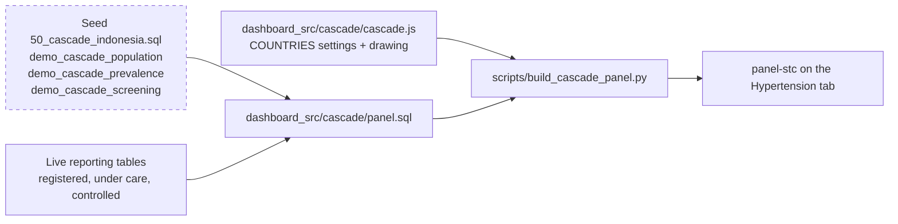

# Architecture Spine — hypertension cascades (front-end build)

## Design Paradigm

The data moves in one direction. The dashed boxes are temporary. Gyan's 0.8.0 stories replace them.

## Inherited Invariants

| Inherited | From parent | Binds here |
| --- | --- | --- |
| AD-14 | MVP spine | The panel reads as `heart360tk_cached` through `postgres-hypertension-cached`. The demo tables get `SELECT` for the read roles only. |
| AD-17 | MVP spine | Only the reviewed program-dashboard edits are allowed. This spine adds `panel-stc` and the Overview row layout as reviewed edits (owner request, 2026-11-18). |
| AD-34 | MVP spine | The seed only adds rows. It does not use `UPDATE`, `DELETE` or `random()`. |
| NFR-1 | MVP PRD | The Diabetes tab, the variables and every other Hypertension panel stay the same. `check_htn_dm_untouched.py` enforces it. |

## Invariants & Rules

### AD-47 — No backend change in this build

- **Binds:** NFR-19, FR-98
- **Prevents:** Work that collides with Gyan's 0.8.0 stories (H360-496, H360-498, H360-499, H360-501, H360-503, H360-504, H360-505).
- **Rule:** Do not add a migration, a function or an API route. Temporary data lives in three `demo_cascade_*` tables that only seed 50 creates. Each table name says "demo".

### AD-48 — The estimate comes from population × prevalence

- **Binds:** FR-94
- **Prevents:** One national estimate for every location (the old 14,500).
- **Rule:** Estimated adults with hypertension = SUM of `adults` for the selected places × `prevalence_pct` ÷ 100, for the year of the month in view. If there is no population row, the estimate is NULL. NULL is not zero.

### AD-49 — One query contract for Gyan

- **Binds:** FR-95, FR-96, FR-101
- **Prevents:** A front-end change when the real tables arrive. A user seeing a place that they cannot access.
- **Rule:**
  - `panel.sql` returns one row with these columns: `reporting_month`, `adults`, `prevalence_pct`, `estimated`, `screening_rows`, `screened`, `raised`, `linked`, `diagnosed`, `registered`, `under_care`, `controlled`.
  - Scope: no location means all org units. Otherwise use the selected unit and its descendants (`get_descendant_ids`).
  - Month: the latest completed month (the `reference_month` variable minus 1 month), the same as the other Hypertension headlines.
  - The query ends with `'${isAllowed}' = '1'`.
  - When the real tables arrive, change only the `FROM` sources in `panel.sql`.

### AD-50 — Settings per country live in the chart code

- **Binds:** FR-97
- **Prevents:** A database table for settings that H360-499 will design. Names fixed in the drawing code.
- **Rule:** `COUNTRIES` in `cascade.js` has one entry per country. Each entry has: name, age group, base text, year start month, target type (`year` or `due`), five step names, step 4 on or off, "set apart" labels and notes, screened target, diagnosed goal and info text. `ACTIVE` picks the country. Indonesia is active. India and Ethiopia are ready.

### AD-51 — One source, one build script, one pinned hash

- **Binds:** FR-89 to FR-93, FR-99, NFR-16, NFR-18
- **Prevents:** Hand edits to the 330 KB dashboard JSON. A second design that drifts from the HTML file.
- **Rule:**
  - Edit only `dashboard_src/cascade/` (`cascade.js`, `cascade.css`, `panel.sql`).
  - `scripts/build_cascade_panel.py` writes `panel-stc` and the Overview row layout. `--check` fails when the dashboard is stale.
  - `check_htn_dm_untouched.py` pins the `panel-stc` hash in `REVIEWED_EDITS` and the grid places in `REVIEWED_LAYOUT`. Update the hash after each change.
  - The drawing code copies `bar()`, `half()` and `screeningBars()` from the HTML design. CSS classes use the prefix `csc-`.

## Consistency Conventions

| Concern | Convention |
| --- | --- |
| Naming | Temporary tables `demo_cascade_*`. Source folder `dashboard_src/cascade/`. CSS prefix `csc-`. |
| Data | Counts are integers. Prevalence is `numeric(5,2)`. Months are the first day of the month (`date`). |
| Demo data | Seed `test_data/demo/seeds/50_cascade_indonesia.sql`. It writes a `demo_seed_marker` row and stops if the row exists. |
| Copy | Follow the review glossary. Say "example data" on the card. |

## Stack

| Name | Version |
| --- | --- |
| Postgres | 16 (existing image) |
| marcusolsson-dynamictext-panel | existing version in the program dashboard |
| Grafana dashboard schema | `dashboard.grafana.app/v2` (existing program dashboard) |

## Deferred

- Real data loads and the target table (Gyan's stories).
- The diagnosis goal formula (estimated − on treatment). The demo uses a fixed goal percent from settings.
- An admin screen for settings.
