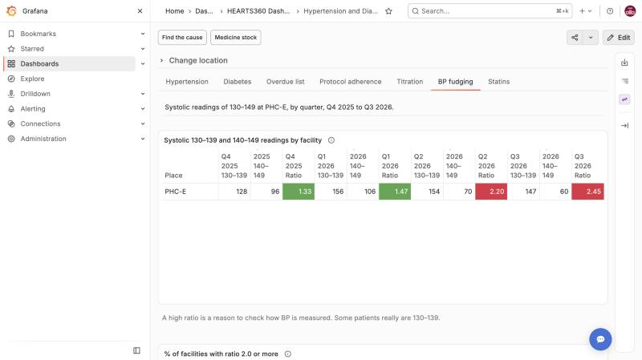
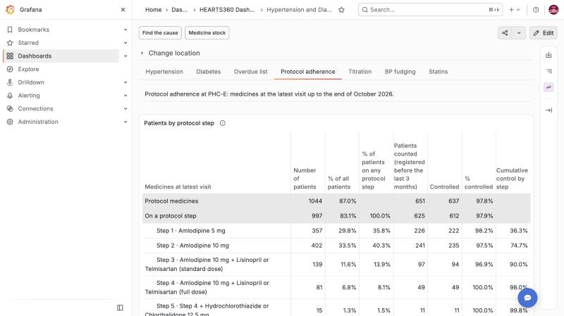
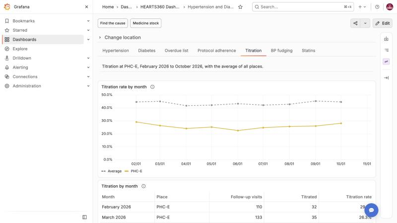
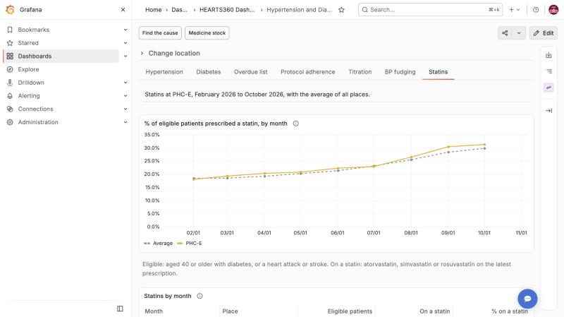
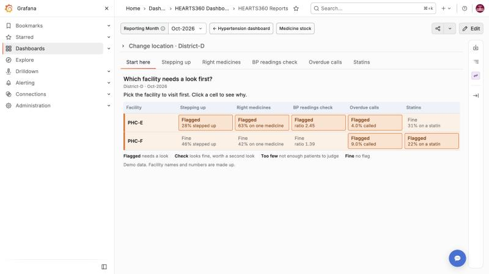
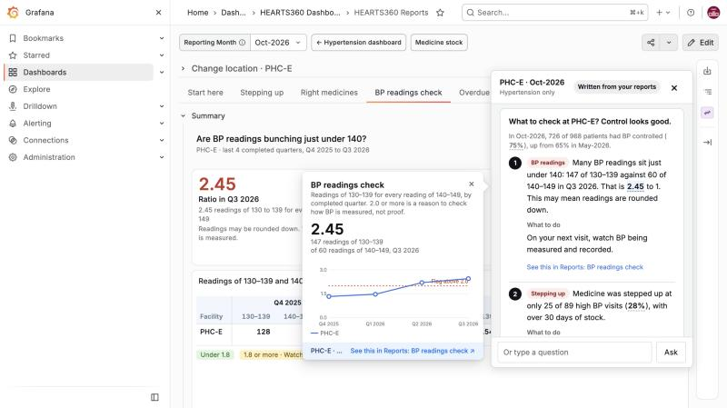
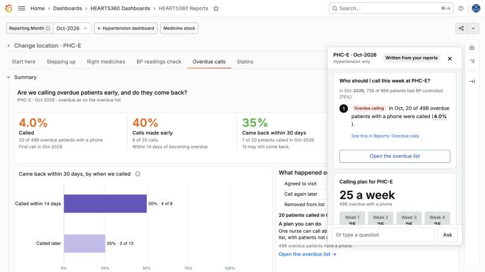
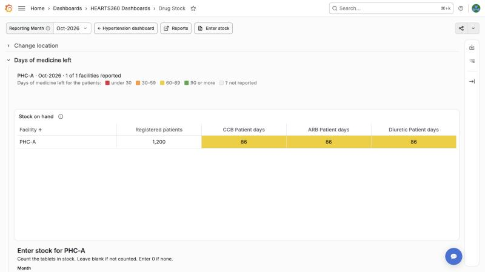

# HEARTS360 demo runbook

**Open only http://localhost:3100. Run the demo in the order below, on month Oct-2026. Do not pull or build anything after the last green `verify_all.sh`.**

This is the experiment branch `cursor/hearts360-mvp-7579`. The 0.7.0 release stack runs on the same machine on the stock ports (Grafana on 3000). Never open localhost:3000 during the demo, and never run `docker compose` for this branch from the release folder.

One page per report explains each number: [protocol adherence](protocol-adherence.md), [titration](titration.md), [BP fudging](bp-fudging.md), [statins](statins.md), [overdue calls](overdue-calls.md), [drug stock](drug-stock.md) and [Ask HEARTS360](ask-hearts360.md).

## 1. Setup

1. Follow the top notice of the [README](../../README.md): its own folder, `.env` with the "Host ports and container names" block, then `./scripts/demo_up.sh`. The full port table is in [Running two stacks](../running-two-stacks.md).
2. Run every script from **bash**, from this folder, and source the ports first:

   ```bash
   bash -c 'source scripts/h360_env.sh; ./scripts/verify_all.sh --keep-going'
   ```

   Do not source `h360_env.sh` from zsh and then run `docker compose`. On 2026-11-05 that left the container prefix empty, and compose tried to rename the demo containers to the release names `postgres` and `grafana`.
3. All checks must say PASS.
4. Sign in at http://localhost:3100 as `admin` / `admin`. The demo Viewers are `district.d` and `nurse.phc-a`, password `demo`.
5. To sign in as a Viewer in the same browser, use http://127.0.0.1:3100. Grafana's session cookie is per host name, so `localhost` and `127.0.0.1` keep separate sessions. This also keeps the release stack's session on localhost:3000 apart.

Place ids depend on upload order. Look them up by name:

```bash
docker exec -i demo-postgres psql -U h360tk_root -d heart360tk_database \
  -c "SELECT id, name FROM heart360tk_schema.org_units WHERE name IN ('District-D', 'PHC-E', 'PHC-A')"
```

Ids change on every reload, so look them up before each demo. Below, `<PHC-E>` and `<District-D>` stand for those ids.

## 2. Run order

| # | Where | Show |
| --- | --- | --- |
| 1 | Home dashboard, `/d/heart360_showcase?var-org_unit=<PHC-E>` | **Hypertension** tab: 75% controlled (726 of 968). Scroll to **Overdue patients**: 498 overdue, 4% called. |
| 2 | Same, **Protocol adherence** tab | The Excel step table. 83% on a protocol step; control rises step by step. |
| 3 | **Titration** tab | PHC-E 28% against an average of 45%, month by month. |
| 4 | **BP fudging** tab | Q3 2026 ratio 2.45, red. Q2 was 2.20. |
| 5 | **Statins** tab | 31% on a statin, 360 eligible. |
| 6 | Reports, **Start here**, `/d/heart360_reports?var-org_unit=<District-D>` | District-D grid. PHC-E flagged on Stepping up, Right medicines, BP readings check and Overdue calls. Click a cell. |
| 7 | Reports, **BP readings check** at District-D, then click PHC-E | Same 2.45 as the home tab. |
| 8 | Reports, **Stepping up** at District-D | 41% (123 of 302); PHC-E 28% with "Control looks fine, check stock". |
| 9 | Ask HEARTS360 at PHC-E | "Why is my BP control low?" Hover **2.45** to show the evidence card, then click "See this in Reports". |
| 10 | Ask HEARTS360 at PHC-E | "Who should I call this week?" Show the plan card: 25 a week, 100 in 4 weeks. Click **Open the overdue list**. |
| 11 | Sign in as `nurse.phc-a` at http://127.0.0.1:3100 | Open the **Overdue list** tab at PHC-A. Change one patient to "Agreed to visit". It saves at once; "Last contacted" shows today. |

Optional: the drug stock board at PHC-A as `nurse.phc-a`. **Enter stock**, save one count, and the board moves to that month.

Numbers above are for the demo database as loaded on 2026-11-05. A save in step 11 or on the stock form adds rows for Nov-2026, so the Oct-2026 numbers do not move.

## 3. Screenshots

| | |
| --- | --- |
| Home, BP fudging |  |
| Home, Protocol adherence |  |
| Home, Titration |  |
| Home, Statins |  |
| Reports, Start here (District-D) |  |
| Chat answer with the evidence card |  |
| Chat calling plan |  |
| Drug stock board (PHC-A, nurse.phc-a) |  |

## 4. The pinned month

The demo data ends on 2026-10-13, so the demo runs on **Oct-2026**.

- **Reports** pins it: the `reporting_month` variable defaults to `2026-10-01` in `dashboard_src/reports/_shell.json`.
- **Home dashboard tabs** and the **drug stock board** use the latest completed month from the clock. That is Oct-2026 until 30 November 2026.
- **Ask HEARTS360** uses the month in the page address, else the latest completed month.

To change the month for one session, pick it in the **Reporting Month** list, or put `var-reporting_month=YYYY-MM-01` in the address. Links and chat answers keep it.

To change or revert the pinned default after the demo, edit `current` of `reporting_month` in `dashboard_src/reports/_shell.json` (or remove it to fall back to the latest completed month), then run `python3 scripts/build_reports_dashboard.py`. Grafana reloads the file within 10 seconds. If you demo on or after 1 December 2026, the home tabs move to Nov-2026: check the numbers first.

## 5. Image freeze

**Rule: no `docker pull` and no build after the last green `verify_all.sh`.** A new Grafana image or a rebuilt container can change what the demo shows.

Images at the last green run (2026-11-05, `docker images --digests`, locally built images show their image digest):

```text
REPOSITORY                          TAG                 DIGEST
h360tk_grafana_core-demo-h360-api   latest              sha256:e72c6065219b4c8edc26f9b077ecabc3eaf9182d52a0d33169cdf14df1374eb9
h360tk_grafana_core-demo-grafana    latest              sha256:561e806652cc644f0af4be54480129ce9cb95a1cc7dc9032b54f8ba56e3c4c70
h360tk_grafana_core-demo-postgres   latest              sha256:d484409cebe61b58fb31596f670205e574d866ff02e7fca48bdbfdbd3fc2a7d2
h360tk_grafana_core-demo-exporter   latest              sha256:5cdd8890c86a6a886048cd149a320c04b7143e94fb11217040e7ccf232f40f80
h360tk_grafana_core-demo-importer   latest              sha256:2eeff58083a09e738540f938512b4d960cb5fa9c9c90a990d339630946f1a3d7
gtstef/filebrowser                  stable-slim         sha256:0a7245e7a1c86ade5608fa4e94385524aa4d066c7d57d905e00474adb379cc17
postgres                            16-alpine           sha256:721873c34ceb9f8d8fc265984940dc982404c105f19ad51be9fdc5970a6080ea
devodev/inotify                     latest              sha256:092367c31c6472a4965f1f80defbb220d259aace66893be7688cb474a8587cc8
dpage/pgadmin4                      9.14                sha256:ff557f69d9808085dc3554f56c1b06a36ac8cddabe4485212920b9604261abdb
```

Run `docker images --digests` before the demo and compare.

## 6. HTN and DM numbers

The **Hypertension** and **Diabetes** tab numbers come from the demo file `test_data/demo/demo_generated.xlsx`, so they differ from any earlier recording. The tab definitions do not change: `scripts/check_htn_dm_untouched.py` checks them against the reviewed baseline (git `08a2894`), with one reviewed addition, the **Overdue patients** section. Numbers move with the data; panels, queries and variables do not.

## 7. Known gaps

- The Hypertension tab's **Overdue patients** column "returned to care" counts visits within 15 days of a call. The Reports tab and the chat count 30 days. See [overdue calls](overdue-calls.md).
- A Viewer who opens the home dashboard with no place in the address sees "No data". Enter through the Home page, which links to the Viewer's own place. Reports and the drug stock board move the Viewer to their place by themselves.
- The importer container (`demo-h360tk-importer`) restarts every minute: `SFTP_PORT` and `SFTP_TIMEOUT` are not set in `.env`. The demo data is already loaded, so the demo does not need it.
